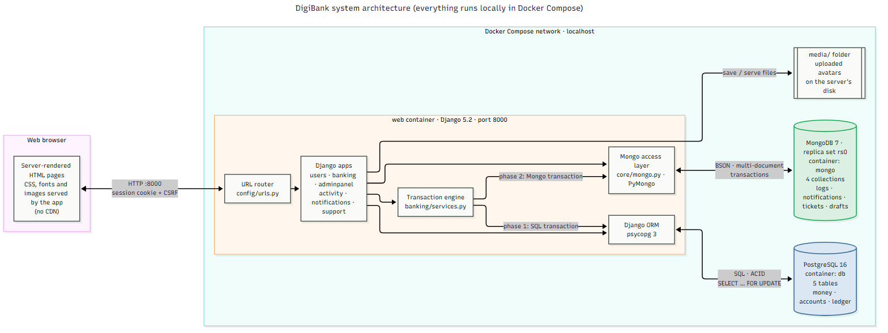
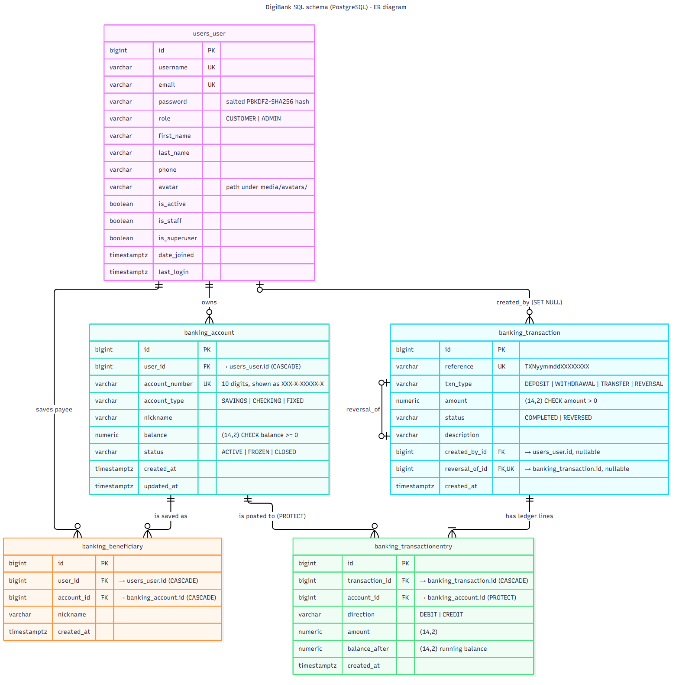
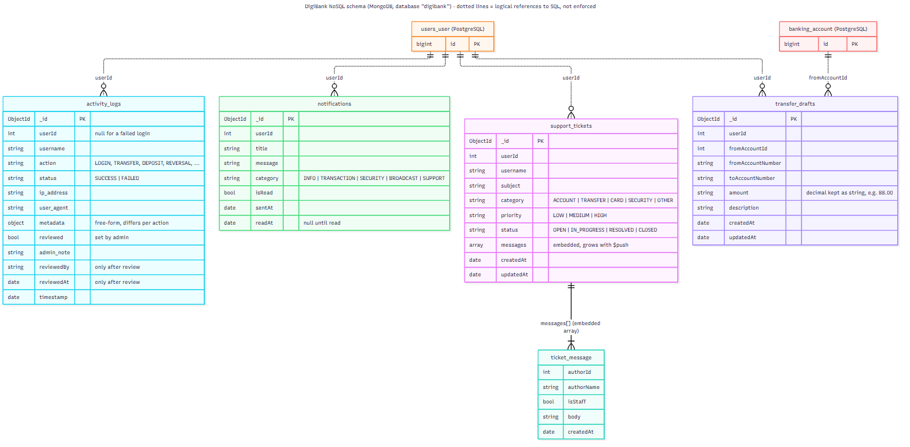
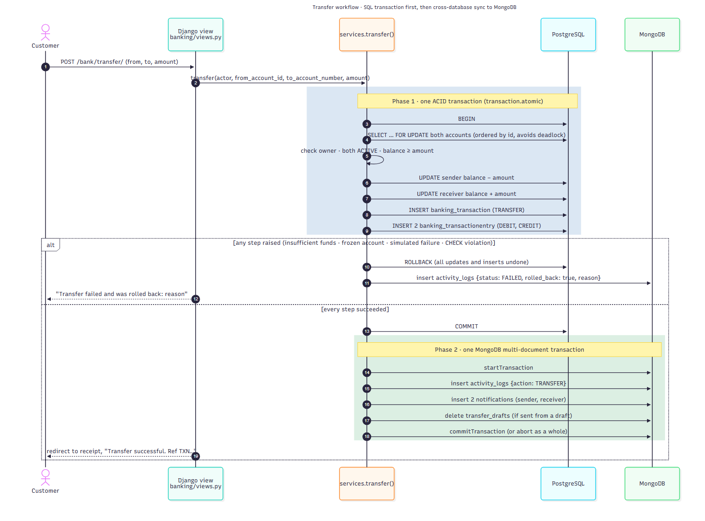
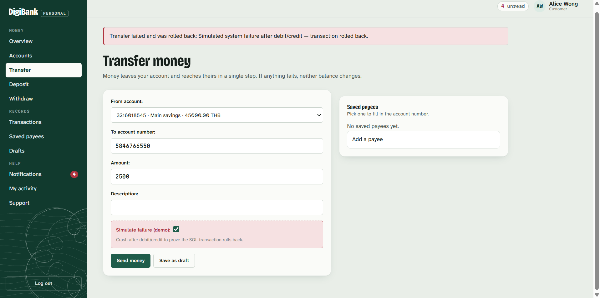
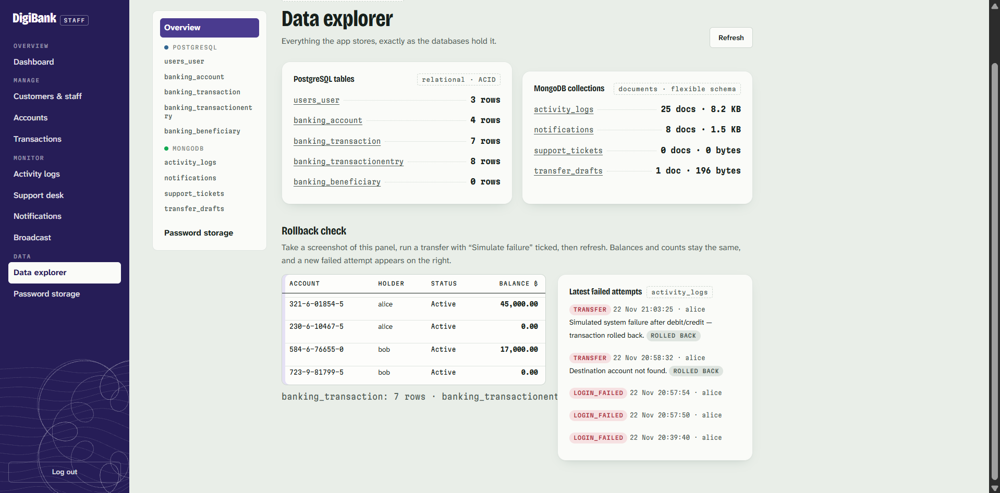

# DigiBank — Hybrid SQL + NoSQL Digital Banking System

A full-stack web app for a digital bank, built on a hybrid database design: **PostgreSQL** holds the money and **MongoDB** holds the flexible, high-volume data around it.

- **Customers** open accounts, deposit, withdraw and transfer money, keep saved payees and transfer drafts, read notifications, raise support tickets and review their own activity.
- **Bank staff (admin)** see a daily dashboard, manage users and accounts (freeze, counter deposits), reverse transactions, review activity logs, answer support tickets, broadcast notifications, and inspect both databases in the built-in Data explorer.

| Layer | Technology |
|---|---|
| Web / backend | Django 5.2, server-rendered templates |
| SQL database | PostgreSQL 16: users, accounts, transactions, double-entry ledger (ACID) |
| NoSQL database | MongoDB 7, single-node replica set `rs0` (needed for multi-document transactions) |
| Runtime | Docker Compose: `web`, `db`, `mongo`, all running locally |
| Files | Avatars stored on the server's disk (`media/`); CSS, fonts and images served from `static/` |

**Fully self-contained:** no external APIs, no CDNs, no cloud databases.

---

## Presentation video

[](https://www.youtube.com/watch?v=LNgHOB2VxnU)

**Watch on YouTube:** https://www.youtube.com/watch?v=LNgHOB2VxnU (about 10 minutes)

The video explains the problem and our solution, describes databases, SQL and NoSQL, and demonstrates the app, including a transaction rollback.

---

## Contents

1. [Presentation video](#presentation-video)
2. [Quick start](#quick-start)
3. [Configuration](#configuration)
4. [Architecture & diagrams](#architecture--diagrams)
5. [Project structure](#project-structure)
6. [Database design](#database-design)
7. [CRUD coverage](#crud-coverage)
8. [Transactions & rollback](#transactions--rollback)
9. [Security](#security)
10. [Routes (API documentation)](#routes-api-documentation)
11. [Inspecting the data](#inspecting-the-data)
12. [Screenshots](#screenshots)
13. [Team](#team)

---

## Quick start

Requirements: Docker Desktop (with Docker Compose v2).

```bash
cp .env.example .env
docker compose up -d --build
docker compose exec web python manage.py seed_demo
```

Open **http://localhost:8000**. On start the `web` container runs `migrate` and `init_mongo` (creates the collections and indexes) automatically.

| Demo login (local development only) | Password | Role |
|---|---|---|
| `admin` | `Admin@12345` | Bank staff |
| `alice` | `Customer@123` | Customer (฿50,000 opening deposit) |
| `bob` | `Customer@123` | Customer (฿12,000 opening deposit) |

Useful commands:

```bash
docker compose logs -f web                              # server logs
docker compose exec web python manage.py makemigrations  # after changing models
docker compose exec web python manage.py changepassword <username>
docker compose down        # stop, keep data
docker compose down -v     # stop and wipe both databases
```

---

## Configuration

All settings come from `.env` (copy it from `.env.example`). `.env` is git-ignored.

| Variable | Default | Purpose |
|---|---|---|
| `DJANGO_SECRET_KEY` | `change-me-dev-only` | Django signing key; change it outside local development |
| `DJANGO_DEBUG` | `1` | `1` = debug mode (also serves uploaded media) |
| `DJANGO_ALLOWED_HOSTS` | `*` | Comma-separated host names |
| `POSTGRES_DB` / `POSTGRES_USER` / `POSTGRES_PASSWORD` | `digibank` | PostgreSQL database and credentials |
| `POSTGRES_HOST` / `POSTGRES_PORT` | `db` / `5432` | PostgreSQL address inside the Docker network |
| `MONGO_URI` | `mongodb://mongo:27017/?replicaSet=rs0` | MongoDB connection string |
| `MONGO_DB_NAME` | `digibank` | MongoDB database name |

Ports published to your machine: app `8000`, PostgreSQL `5433`, MongoDB `27018` (not the defaults, so they don't clash with locally installed databases).

---

## Architecture & diagrams



The browser talks only to the Django container. Django reaches PostgreSQL through the ORM and MongoDB through PyMongo, all inside one Docker Compose network. Every money movement goes through the transaction engine (`banking/services.py`): phase 1 in PostgreSQL, then phase 2 in MongoDB.

| Diagram | Source (Mermaid) | Image |
|---|---|---|
| System architecture | [architecture.md](docs/diagrams/architecture.md) | [architecture.png](docs/diagrams/architecture.png) |
| SQL ER diagram | [er-diagram.md](docs/diagrams/er-diagram.md) | [er-diagram.png](docs/diagrams/er-diagram.png) |
| NoSQL document schema | [nosql-schema.md](docs/diagrams/nosql-schema.md) | [nosql-schema.png](docs/diagrams/nosql-schema.png) |
| Transfer workflow (transaction + rollback) | [transfer-flow.md](docs/diagrams/transfer-flow.md) | [transfer-flow.png](docs/diagrams/transfer-flow.png) |

The `.md` files are the source of truth. To change a diagram, edit its Mermaid block (try it at https://mermaid.live), then regenerate the PNGs from the project folder (PowerShell):

```powershell
foreach ($f in "architecture","er-diagram","nosql-schema","transfer-flow") { npx -y @mermaid-js/mermaid-cli -i "docs/diagrams/$f.md" -o "docs/diagrams/$f.png" -s 2 -b white; Move-Item -Force "docs/diagrams/$f-1.png" "docs/diagrams/$f.png" }
```

---

## Project structure

```
config/          settings, root URL routes
core/            shared code: Mongo client (mongo.py), role decorators, display filters
                 (templatetags/bank.py), management commands init_mongo + seed_demo
users/           SQL   · custom User (role, phone, avatar) · register, login, profile
banking/         SQL   · Account, Transaction, TransactionEntry, Beneficiary
                 services.py = every money movement (atomic transactions)
                 Mongo · transfer_drafts
activity/        Mongo · activity_logs (audit trail, login/logout signals)
notifications/   Mongo · notifications (+ admin broadcast)
support/         Mongo · support_tickets (embedded reply thread)
adminpanel/      staff dashboard, user/account/transaction management, data explorer
templates/       base layout, shared form/confirm/auth pages
static/          app.css, self-hosted fonts, guilloche pattern
docs/            diagrams/ and screenshots/
```

---

## Database design

### SQL: PostgreSQL (5 tables)



| Table | Key columns | Constraints |
|---|---|---|
| `users_user` | id, username, email, password (hash), role, phone, avatar | username UNIQUE, email UNIQUE |
| `banking_account` | id, user_id → users_user, account_number, account_type, nickname, balance, status | account_number UNIQUE, **CHECK balance ≥ 0** |
| `banking_transaction` | id, reference, txn_type, amount, status, description, created_by_id → users_user, reversal_of_id → self | reference UNIQUE, CHECK amount > 0 |
| `banking_transactionentry` | id, transaction_id → banking_transaction, account_id → banking_account, direction, amount, balance_after | double-entry ledger lines; account FK is PROTECT |
| `banking_beneficiary` | id, user_id → users_user, account_id → banking_account, nickname | UNIQUE(user, account) |

### NoSQL: MongoDB (4 collections)



Dotted lines are references to SQL rows by id. MongoDB doesn't enforce them; the app keeps them consistent.

| Collection | Document fields | Why a document store |
|---|---|---|
| `activity_logs` | userId, username, action, status, ip_address, user_agent, metadata{}, reviewed, admin_note, timestamp | High write volume; `metadata` has a different shape per action |
| `notifications` | userId, title, message, category, isRead, sentAt, readAt | Simple per-user feed, written in bulk by broadcasts |
| `support_tickets` | userId, username, subject, category, priority, status, messages[ ], createdAt, updatedAt | The reply thread is embedded and grows with `$push` |
| `transfer_drafts` | userId, fromAccountId, fromAccountNumber, toAccountNumber, amount, description, createdAt, updatedAt | Temporary data, deleted when sent (like a shopping cart) |

---

## CRUD coverage

| Entity | Create | Read | Update | Delete |
|---|---|---|---|---|
| User (SQL) | register, admin create | profile, admin list + detail | profile edit, password change, admin edit, activate/deactivate | admin delete (blocked by FK if the user has history) |
| Account (SQL) | customer opens, admin opens for a user | overview, passbook statement | rename, admin type/status (freeze) | close: marked CLOSED if it has history, deleted if empty |
| Transaction + entries (SQL) | deposit, withdraw, transfer, counter deposit | lists, receipt, statement | admin reversal (status → REVERSED) | admin deletes a reversed record |
| Beneficiary (SQL) | add payee | list | rename | remove |
| transfer_drafts (Mongo) | save draft | list | edit | delete, or removed automatically when sent |
| notifications (Mongo) | system events, admin broadcast | list, unread filter | mark read, mark all read | dismiss, clear read |
| activity_logs (Mongo) | automatic on every action | my activity, admin filters | admin review + note | admin delete |
| support_tickets (Mongo) | open ticket | list, thread | reply (`$push`), edit, status | delete |

---

## Transactions & rollback

All money movement is in [banking/services.py](banking/services.py).



**Phase 1: one PostgreSQL transaction** (`transaction.atomic`)
1. `SELECT … FOR UPDATE` on both accounts, locked in id order to avoid deadlocks
2. Check ownership, that both accounts are ACTIVE, and that the balance covers the amount
3. Debit the sender, credit the receiver
4. Insert the `banking_transaction` row and two `banking_transactionentry` rows (DEBIT + CREDIT)
5. Any error rolls back **every** step. The database also enforces `CHECK balance >= 0`.

**Phase 2: cross-database sync** (one MongoDB multi-document transaction, only after the SQL commit)
- insert the activity log, insert notifications for sender and receiver, delete the draft that was sent: all or nothing.

**Failures are recorded:** a failed attempt writes an `activity_logs` document with `status: "FAILED"`, `rolled_back: true` and the reason.

**Demonstrating a rollback:** on the Transfer page, tick **Simulate failure (demo)**. The app debits and credits, then raises an error on purpose. Balances and the transaction count don't change. Compare before and after in *Admin → Data explorer → Rollback check*. Other real failures: insufficient funds, transfer to a frozen account, reversing money the receiver has already spent.

Other atomic workflows: registration (user + first account), deposit, withdrawal, admin reversal, account closing.

---

## Security

- **Passwords** are stored as salted PBKDF2-SHA256 hashes (Django's default), never as plain text. *Admin → Password storage* breaks a stored hash into algorithm, iterations, salt and hash.
- **Role checks** on every view: customers can't open admin pages (403), staff are redirected away from customer pages, and customers can only see their own accounts, drafts, tickets and notifications (others return 404).
- **CSRF protection** on every form; every state-changing action uses POST.
- **SQL safety:** the ORM and parameterised queries throughout. The Data explorer only reads tables and collections on a fixed whitelist.
- **Secrets** live in `.env`, which is git-ignored.

---

## Routes (API documentation)

The app is server-rendered, so its interface is the set of URL routes below. `GET` shows a page; `POST` submits it. Mongo IDs are 24-character ObjectId strings.

### Public and account

| Route | Methods | Who | Purpose |
|---|---|---|---|
| `/` | GET | any | Redirects to the right home page for the role |
| `/users/register/` | GET, POST | signed out | Create a customer + first savings account |
| `/users/login/` · `/users/logout/` | GET, POST · POST | any | Sign in · sign out |
| `/users/profile/` | GET | signed in | View profile |
| `/users/profile/edit/` | GET, POST | signed in | Edit name, email, phone, avatar |
| `/users/profile/password/` | GET, POST | signed in | Change password |

### Customer banking (`/bank/`)

| Route | Methods | Database | Purpose |
|---|---|---|---|
| `/bank/` | GET | SQL + Mongo | Overview: total balance, accounts, recent transactions |
| `/bank/accounts/` · `/bank/accounts/open/` | GET · GET, POST | SQL | List accounts · open an account |
| `/bank/accounts/<id>/` | GET | SQL | Account passbook |
| `/bank/accounts/<id>/edit/` · `/close/` | GET, POST | SQL | Rename · close |
| `/bank/deposit/` · `/bank/withdraw/` | GET, POST | SQL → Mongo | Atomic deposit · withdrawal |
| `/bank/transfer/` | GET, POST | SQL → Mongo | Atomic transfer, or save as draft |
| `/bank/transactions/` · `/<id>/` | GET | SQL | History · receipt with ledger lines |
| `/bank/beneficiaries/` · `/add/` · `/<id>/edit/` · `/<id>/delete/` | GET, POST | SQL | Saved payees CRUD |
| `/bank/drafts/` · `/new/` · `/<oid>/edit/` · `/<oid>/delete/` | GET, POST | Mongo | Transfer drafts CRUD |
| `/bank/drafts/<oid>/execute/` | POST | SQL → Mongo | Send a draft as a real transfer |

### Notifications, activity, support

| Route | Methods | Who | Purpose |
|---|---|---|---|
| `/notifications/` | GET | signed in | Own notifications (staff: all); `?unread=1` |
| `/notifications/<oid>/read/` · `/delete/` | POST | signed in | Mark read · dismiss |
| `/notifications/read-all/` · `/clear/` | POST | customer | Mark all read · clear read ones |
| `/notifications/broadcast/` | GET, POST | staff | Send to one user or all customers |
| `/activity/` | GET | signed in | Own activity log |
| `/activity/all/` | GET | staff | All logs; filters `action`, `status`, `username`, `unreviewed` |
| `/activity/<oid>/edit/` · `/delete/` | GET, POST | staff | Review with note · delete |
| `/support/` · `/support/new/` | GET · GET, POST | signed in · customer | Ticket list (`?status=`) · new ticket |
| `/support/<oid>/` | GET, POST | owner, staff | Thread and reply |
| `/support/<oid>/edit/` · `/status/` · `/delete/` | GET, POST · POST · GET, POST | owner, staff | Edit · change status · delete |

### Staff back office (`/admin-panel/`)

| Route | Methods | Purpose |
|---|---|---|
| `/admin-panel/` | GET | Day sheet: SQL + Mongo figures, latest transactions and activity |
| `/admin-panel/users/` · `/new/` | GET · GET, POST | List and search users · create user |
| `/admin-panel/users/<id>/` · `/edit/` · `/toggle-active/` · `/delete/` | GET · GET, POST · POST · GET, POST | User detail · edit · activate/deactivate · delete |
| `/admin-panel/users/<id>/accounts/new/` | GET, POST | Open an account for a user |
| `/admin-panel/accounts/` · `/<id>/` | GET · GET, POST | All accounts · detail + counter deposit/withdrawal |
| `/admin-panel/accounts/<id>/edit/` · `/delete/` | GET, POST | Change type/status (freeze) · close |
| `/admin-panel/transactions/` · `/<id>/` | GET | All transactions (filters) · detail |
| `/admin-panel/transactions/<id>/reverse/` · `/delete/` | GET, POST | Atomic reversal · delete a reversed record |
| `/admin-panel/data/` | GET | Data explorer overview + rollback check |
| `/admin-panel/data/sql/<table>/` | GET | Columns, constraints and raw rows; `?q=` search |
| `/admin-panel/data/mongo/<collection>/` | GET | Fields, indexes and raw documents; `?field=&value=` |
| `/admin-panel/data/passwords/` | GET, POST | How passwords are hashed, with a try-it form |
| `/django-admin/` | GET, POST | Django's built-in admin (superuser) |

---

## Inspecting the data

- **In the app:** sign in as `admin` → **Data explorer**. It shows every table and collection as stored, with a before/after rollback check.
- **Command line:**
  ```bash
  docker compose exec db psql -U digibank -d digibank
  docker compose exec mongo mongosh digibank
  ```
- **Desktop tools:** pgAdmin or DBeaver → `localhost:5433` (digibank / digibank); MongoDB Compass → `mongodb://localhost:27018/?directConnection=true`.

---

## Screenshots

21 screenshots of the running app are in [docs/screenshots/](docs/screenshots/README.md). That page shows every image with a note on which table or collection it uses.

| Folder | Screenshots | Shows |
|---|---|---|
| [01-sql-postgresql](docs/screenshots/01-sql-postgresql/) | 10 | Registration, login, account overview, profile edit, transaction history, closing an account (rejected and successful), freezing an account, staff dashboard |
| [02-nosql-mongodb](docs/screenshots/02-nosql-mongodb/) | 6 | Transfer drafts, a new support ticket, activity logs, notifications, staff broadcast |
| [03-transaction-proof](docs/screenshots/03-transaction-proof/) | 5 | Deposit, withdrawal and transfer receipts with their ledger lines, a simulated failure, and the rollback check in the Data explorer |

**Rollback proof:** the transfer is forced to fail after the debit and credit, and the Data explorer then shows the balances unchanged and the failed attempt recorded with `rolled_back: true`.

| Failed transfer | Database after the failure |
|---|---|
| [](docs/screenshots/03-transaction-proof/04-simulate-failure.png) | [](docs/screenshots/03-transaction-proof/05-transaction-rollback-proof.png) |

---

## Team

| Member | Student ID |
|---|---|
| Chayapol Kaewsakul | 6810545557 |
| Techasit Suchataunthon | 6810545590 |
| Suppamok Tosranon | 6810545921 |
| Suwat Teiwasuculmetri | 6810545956 |
| Apichai Pattanakamolkul | 6810545972 |
