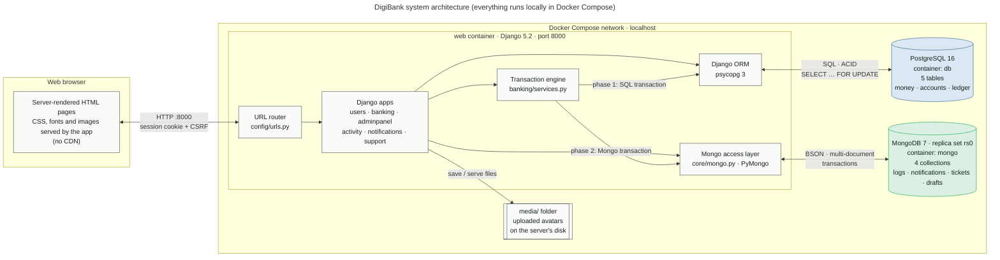

# System architecture

Browser → Django (one container) → PostgreSQL and MongoDB (one container each), all on the Docker Compose network. No external APIs, CDNs or cloud databases: fonts, CSS and uploaded avatars are served from the app itself.

