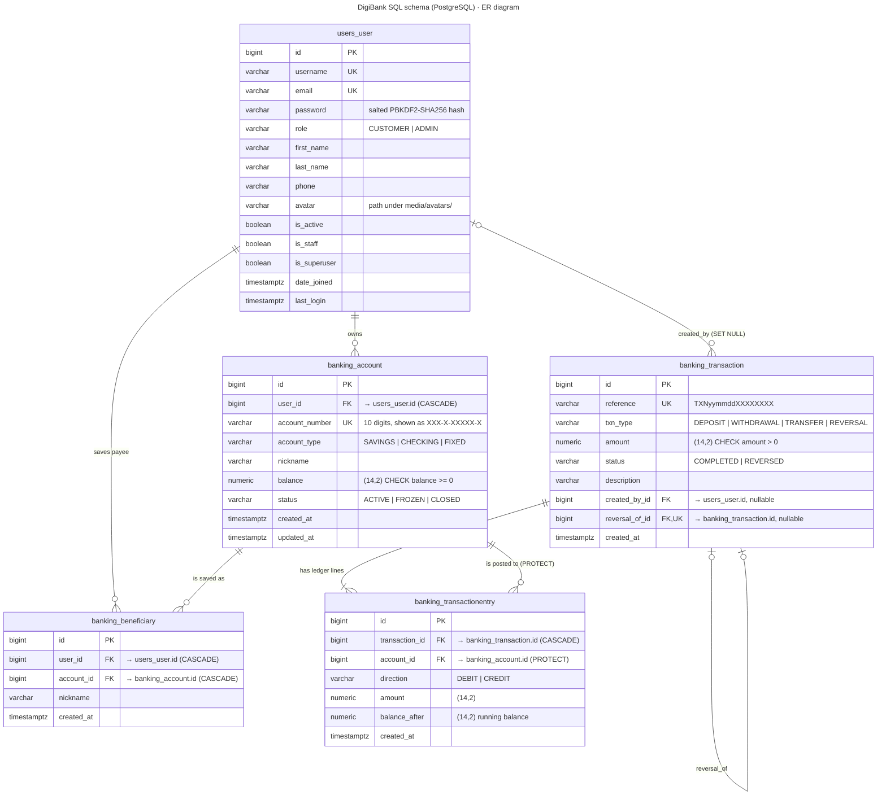

# SQL ER diagram (PostgreSQL)

Five tables. `banking_transactionentry` is the double-entry ledger: a transfer writes one DEBIT and one CREDIT line. `PROTECT` on entries → accounts stops a user or account with history from being deleted. Constraint names: `account_balance_non_negative`, `transaction_amount_positive`, `unique_beneficiary_per_user`.

