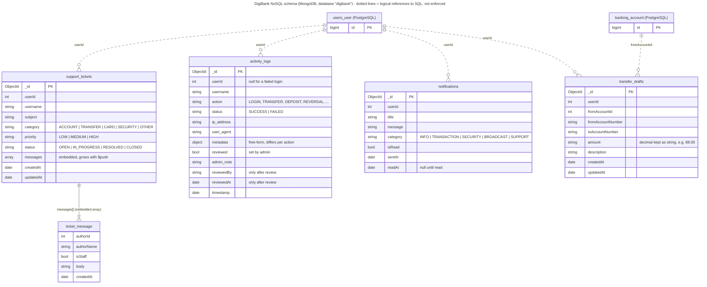

# NoSQL document schema (MongoDB)

Four collections. Ticket replies are embedded in `support_tickets.messages[]` (appended with `$push`). `userId` / `fromAccountId` point to SQL rows by convention; MongoDB does not enforce them.

| Collection | Indexes |
|---|---|
| activity_logs | `{userId: 1, timestamp: -1}`, `{action: 1}` |
| notifications | `{userId: 1, isRead: 1, sentAt: -1}` |
| support_tickets | `{userId: 1, status: 1}` |
| transfer_drafts | `{userId: 1, updatedAt: -1}` |

