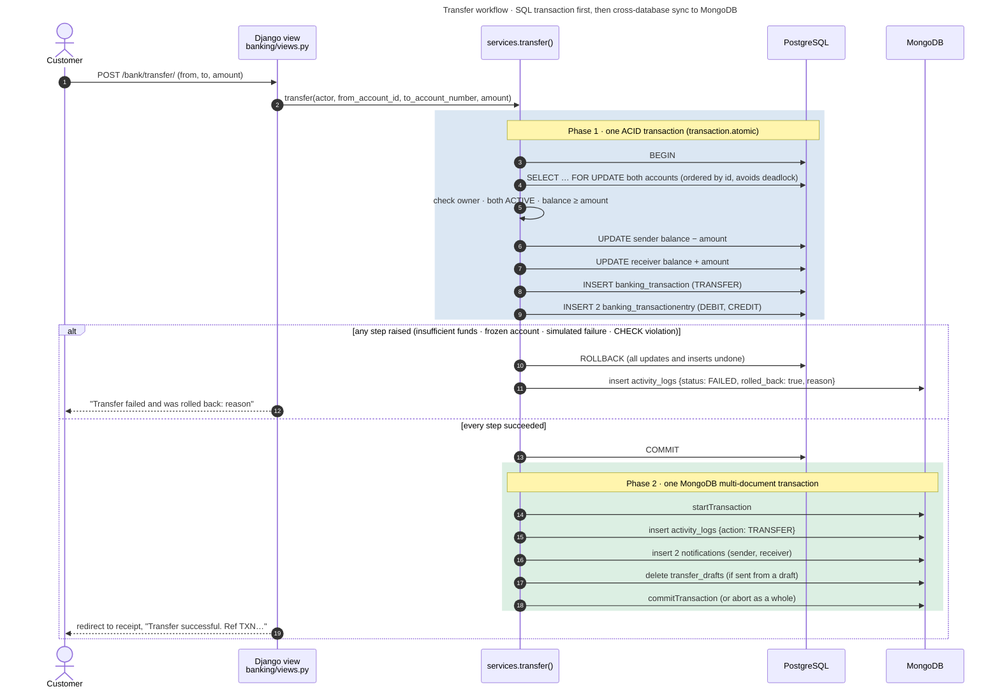

# Transfer workflow (transaction + rollback)

Phase 1 runs in one PostgreSQL transaction; any error rolls back every step. Phase 2 runs only after the SQL commit and writes all MongoDB side effects in one multi-document transaction. Code: `banking/services.py` → `transfer()`.

