# Screenshots

Screenshots of the running DigiBank app, grouped by feature. Each row notes the PostgreSQL table or MongoDB collection used by the feature. Click any image to view it at full size.

This gallery contains **21 screenshots**: 10 SQL, 6 NoSQL and 5 transaction screenshots. Numbers restart in each folder. The capture guides use their own scenario numbers: [SQL shot list](01-sql-postgresql/SHOTLIST.md), [NoSQL shot list](02-nosql-mongodb/SHOTLIST.md), and [Transaction shot list](03-transaction-proof/SHOTLIST.md). This gallery documents the available images; it does not mark every shot-list scenario as complete.

## 1. SQL Features (PostgreSQL)

### 1.1 Authentication & User Management

| # | Screenshot | What it shows |
| --- | --- | --- |
| 01 | [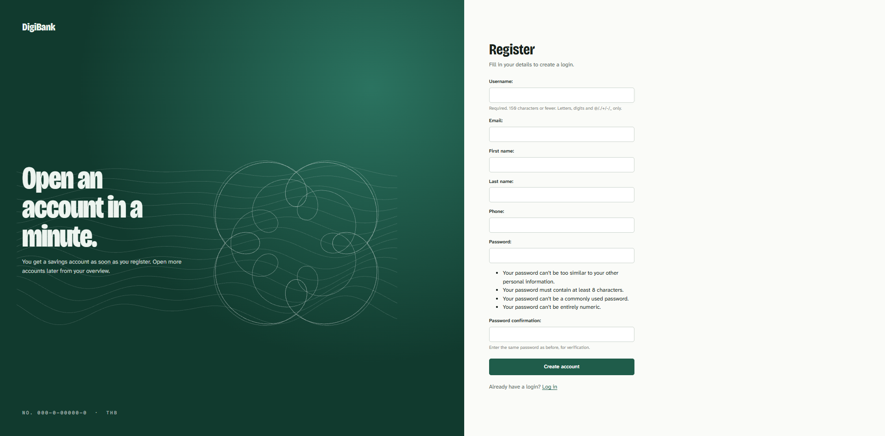](01-sql-postgresql/01-user-account-creation.png) | Registration form for creating a `users_user` record and an initial savings account in `banking_account`, together in one SQL transaction. |
| 02 | [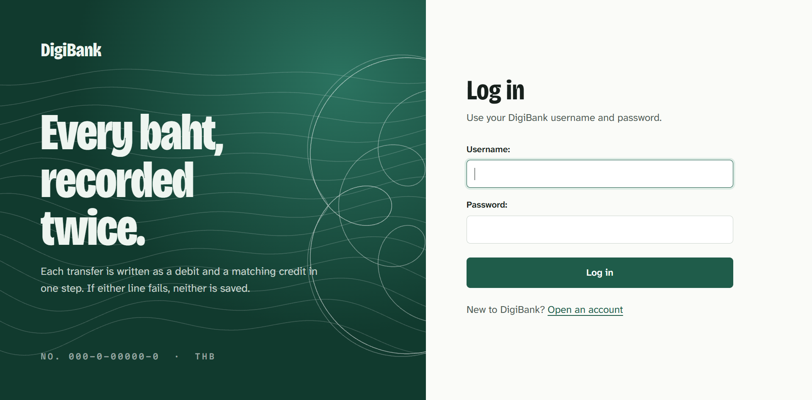](01-sql-postgresql/02-user-account-login.png) | Sign-in form using a username and password, authenticated against `users_user`. |
| 04 | [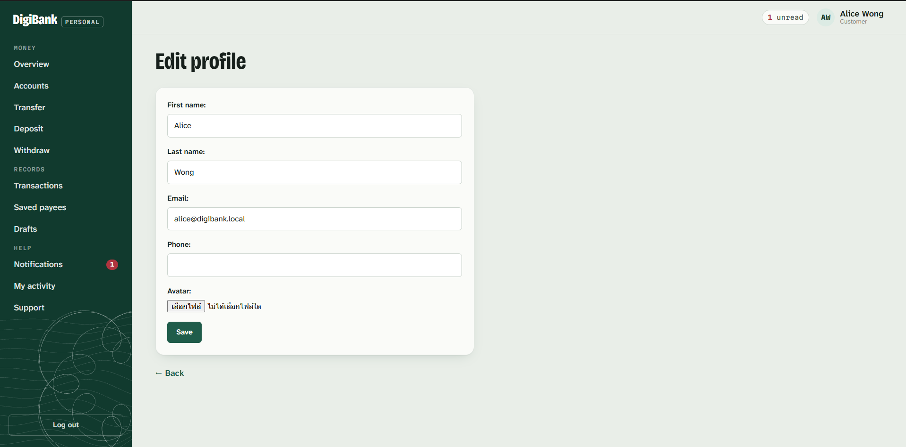](01-sql-postgresql/04-account-modification.png) | Profile form for updating name, email, phone and avatar in `users_user`; uploaded avatar files are stored on disk. |

### 1.2 Account Overview & Transaction History

| # | Screenshot | What it shows |
| --- | --- | --- |
| 03 | [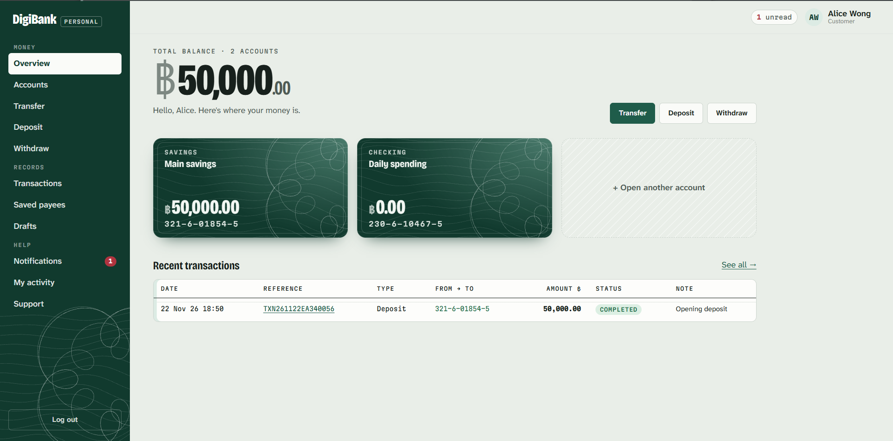](01-sql-postgresql/03-account-listing.png) | Customer overview reading `banking_account`: Alice's savings and checking accounts, a total balance of THB 50,000, and recent transaction history. |
| 05 | [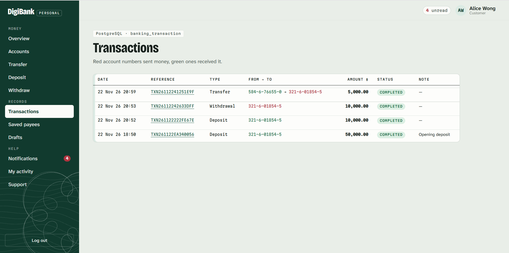](01-sql-postgresql/05-transaction-history.png) | Completed deposits, withdrawal and transfer from `banking_transaction`, with account details linked through `banking_transactionentry` and `banking_account`. |

### 1.3 Account Closure & Freezing

| # | Screenshot | What it shows |
| --- | --- | --- |
| 06 | [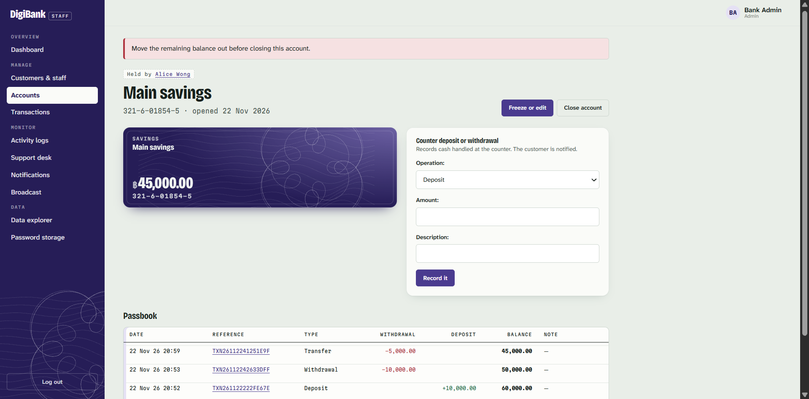](01-sql-postgresql/06-close_accounts_fail.png) | Closing Alice's account is rejected because its balance is THB 45,000. The page also shows the account passbook with deposits, withdrawals and running balances from `banking_transactionentry`. |
| 07 | [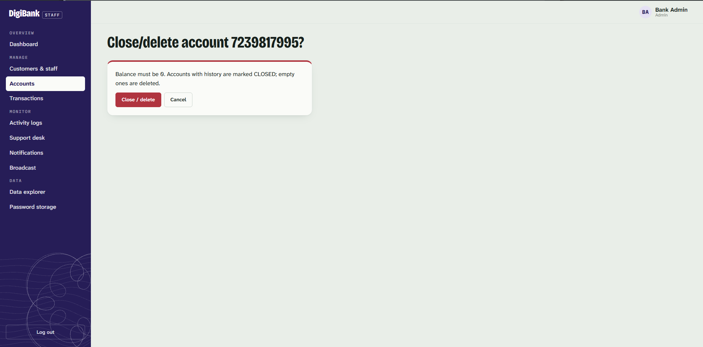](01-sql-postgresql/07-close_account_1.png) | Staff confirmation before closing or deleting a `banking_account`: the balance must be zero; accounts with history are marked closed, while empty accounts without history are deleted. |
| 08 | [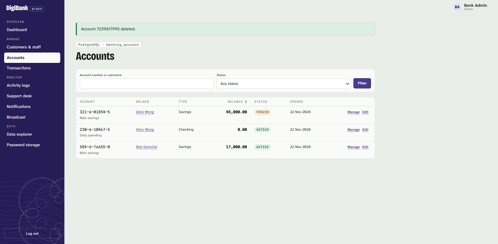](01-sql-postgresql/08-close_account_2success.png) | Success message confirming deletion of Bob's empty account `723-9-81799-5`, followed by the remaining account list. |
| 09 | [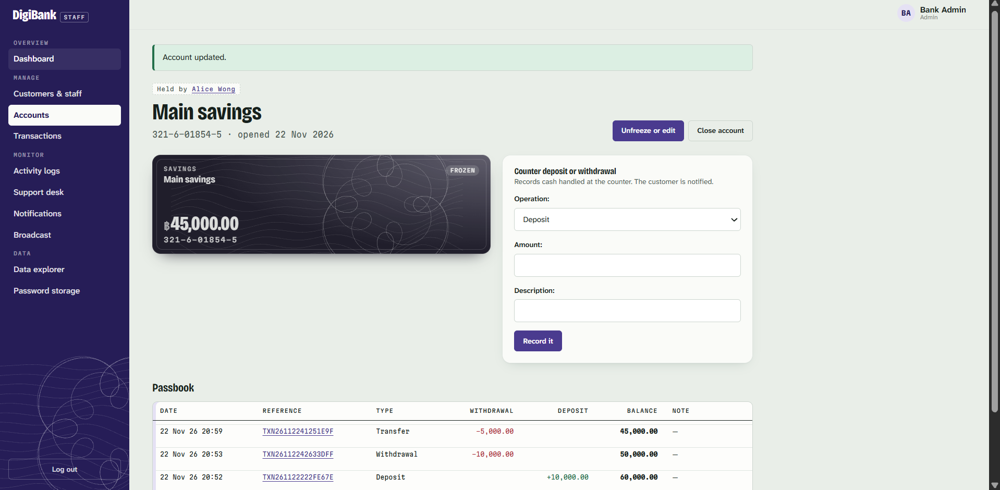](01-sql-postgresql/09-freez_account.png) | Alice's Main savings account after updating `banking_account.status`: a grey card, `FROZEN` badge and account-updated message. |

### 1.4 Staff Dashboard

| # | Screenshot | What it shows |
| --- | --- | --- |
| 10 | [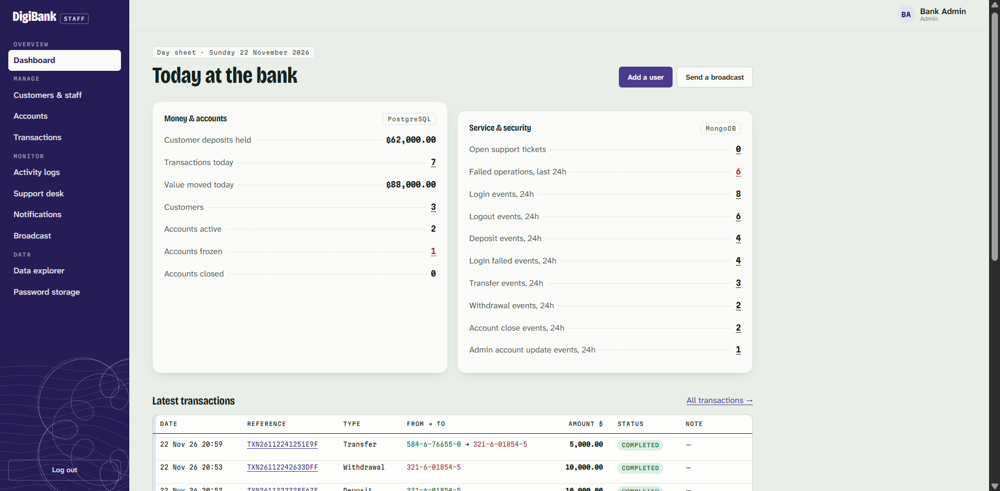](01-sql-postgresql/10-admin_dash_board.png) | Daily dashboard combining PostgreSQL account and transaction totals with MongoDB support and activity statistics, plus recent transactions. |

---

## 2. NoSQL Features (MongoDB)

### 2.1 Transfer Drafts & Support

| # | Screenshot | Collection |
| --- | --- | --- |
| 01 | [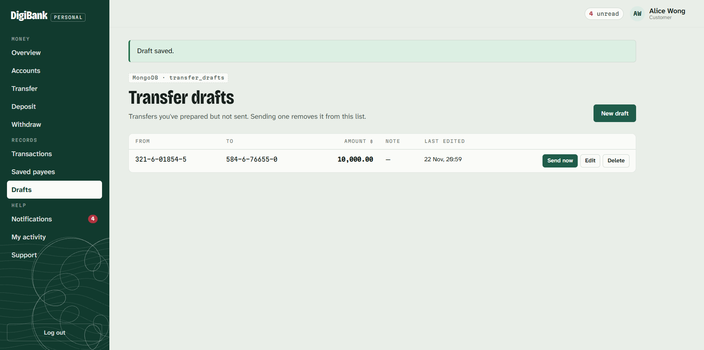](02-nosql-mongodb/01-transfer-drafts.png) | `transfer_drafts`: a saved THB 10,000 transfer with source and destination accounts; controls to send, edit or delete the draft. |
| 02 | [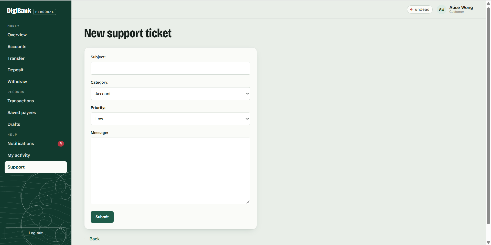](02-nosql-mongodb/02-support-ticket-management.png) | `support_tickets`: form for creating a ticket with subject, category, priority and an initial message. |

### 2.2 Activity Tracking & Notifications

| # | Screenshot | Collection |
| --- | --- | --- |
| 03 | [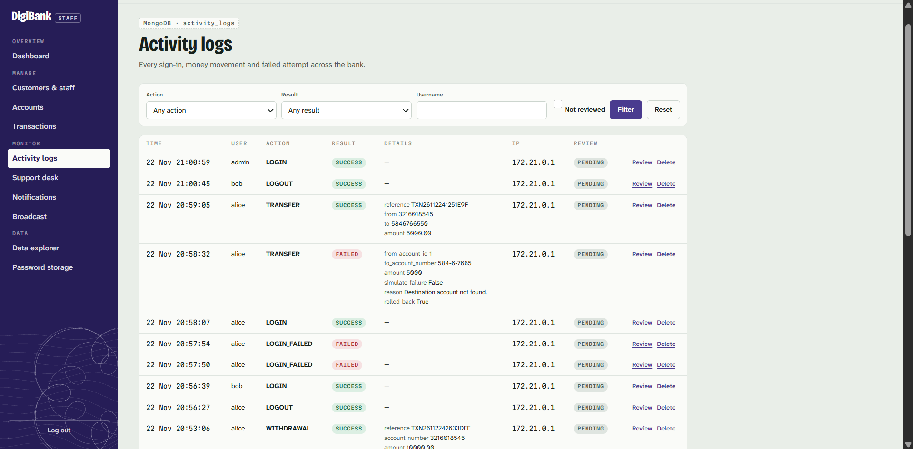](02-nosql-mongodb/03-activity-logs.png) | `activity_logs`: staff audit trail with successful and failed actions, flexible metadata, filters, and review/delete controls. A failed transfer includes its reason and `rolled_back: true`. |
| 04 | [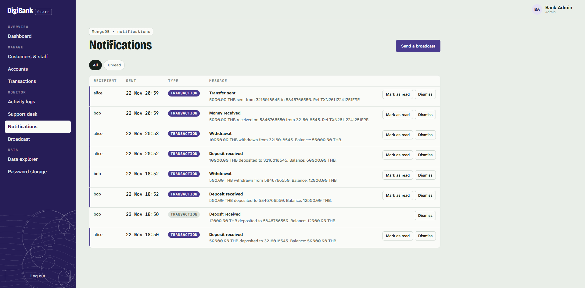](02-nosql-mongodb/04-notifications.png) | `notifications`: staff view of deposit, withdrawal and transfer notifications, including recipient, timestamp, read status, mark-as-read and dismiss controls. |

### 2.3 Staff Broadcast

| # | Screenshot | Collection |
| --- | --- | --- |
| 05 | [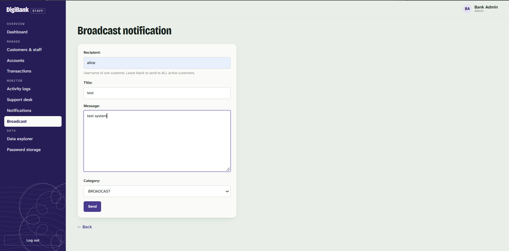](02-nosql-mongodb/05-admin_broadcast.png) | `notifications`: staff form with recipient Alice, a test title/message and the `BROADCAST` category. This example targets one customer. |
| 06 | [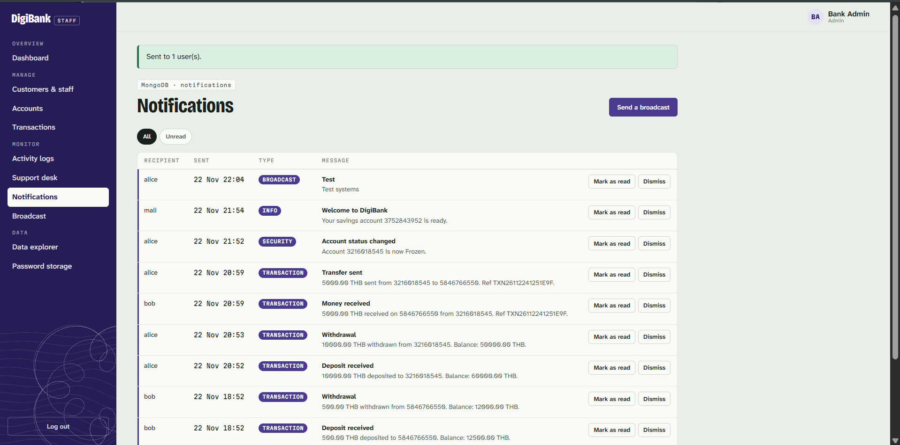](02-nosql-mongodb/06-admin_broadcast_success.png) | `notifications`: successful send confirmed by "Sent to 1 user(s)." and a new broadcast notification for Alice. |

---

## 3. Database Transaction & Rollback Proof

Money movements update `banking_account`, `banking_transaction` and `banking_transactionentry` inside a PostgreSQL `transaction.atomic()` block with row locks. After a successful SQL commit, activity logs and notifications are written in a separate MongoDB transaction.

### 3.1 Successful Deposit & Withdrawal

| # | Screenshot | Scenario | Result |
| --- | --- | --- | --- |
| 01 | [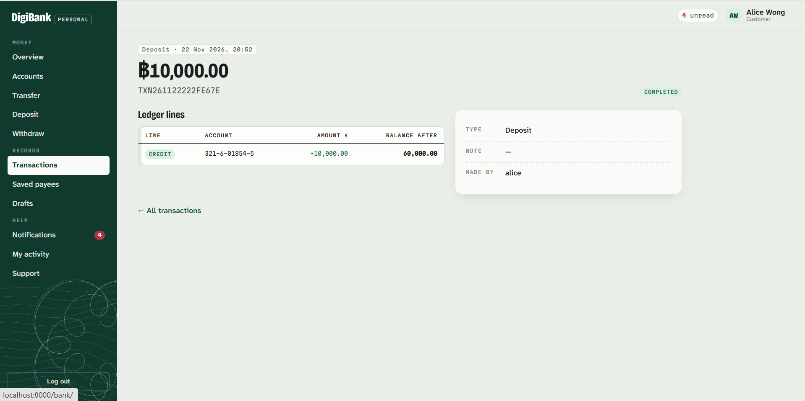](03-transaction-proof/01-Deposit-transaction.png) | Alice deposits THB 10,000. | `COMPLETED` receipt with one `CREDIT` ledger entry; balance after deposit is THB 60,000. |
| 02 | [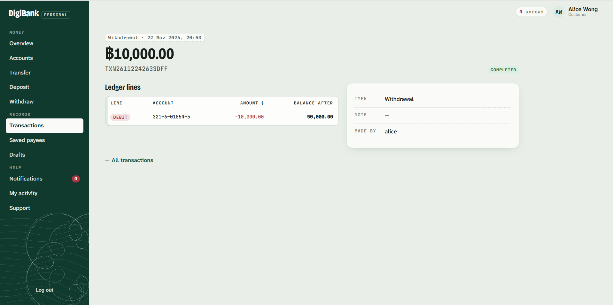](03-transaction-proof/02-Withdraw-transaction.png) | Alice withdraws THB 10,000. | `COMPLETED` receipt with one `DEBIT` ledger entry; balance after withdrawal is THB 50,000. |

### 3.2 Successful Transfer

| # | Screenshot | Scenario | Result |
| --- | --- | --- | --- |
| 03 | [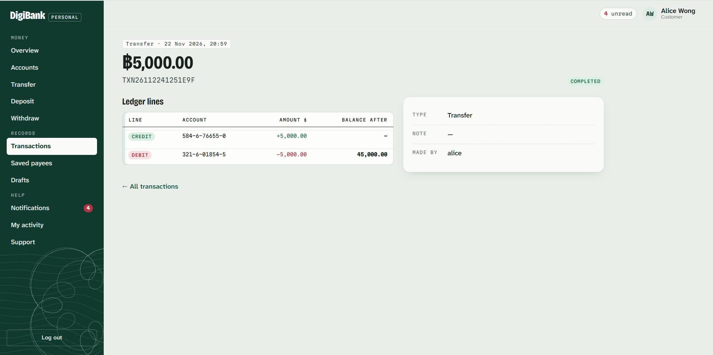](03-transaction-proof/03-transfer-transaction.png) | Alice transfers THB 5,000 from account `321-6-01854-5` to Bob's account `584-6-76655-0`. | `COMPLETED` receipt with matching `DEBIT` and `CREDIT` entries; Alice's balance after transfer is THB 45,000. |

### 3.3 Simulated Failure & Rollback

| # | Screenshot | Scenario | Result |
| --- | --- | --- | --- |
| 04 | [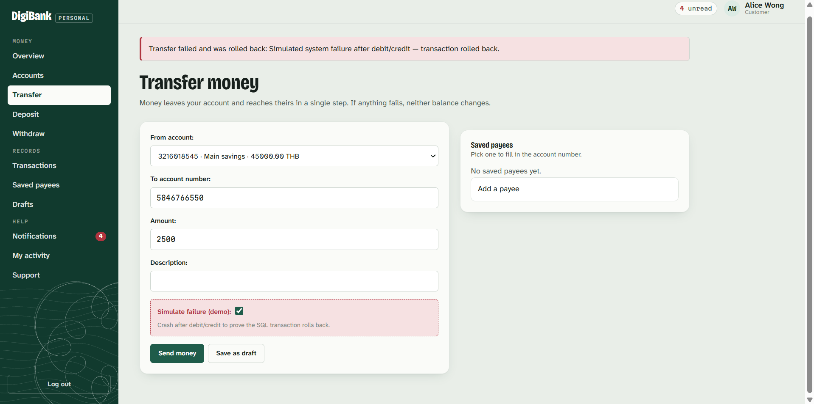](03-transaction-proof/04-simulate-failure.png) | Attempt a THB 2,500 transfer with **Simulate failure (demo)** selected. | Error banner confirms the transfer was rolled back after debit/credit; Alice's account still shows THB 45,000. |
| 05 | [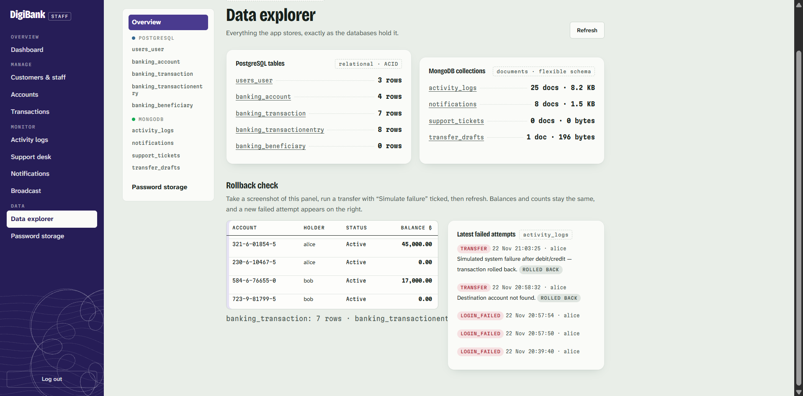](03-transaction-proof/05-transaction-rollback-proof.png) | Inspect **Admin → Data explorer → Rollback check** after the failed transfer. | Alice has THB 45,000 and Bob has THB 17,000. The database contains 7 transaction rows and 8 ledger-entry rows; the failed attempt appears in `activity_logs` with a `ROLLED BACK` badge. |

The simulated exception rolls back both balance updates and the new SQL transaction/ledger rows. The failed attempt is recorded separately in MongoDB. The screenshots show Alice's THB 45,000 balance before the failed attempt (the successful transfer receipt) and after it (the error form and Data explorer). A separate Data explorer capture before the attempt would be needed to compare both account balances and row counts side by side.

---

## 4. System Architecture & Database Diagrams

### 4.1 System Architecture

Browser, Django backend, PostgreSQL and MongoDB connections, and the local Docker Compose setup.

[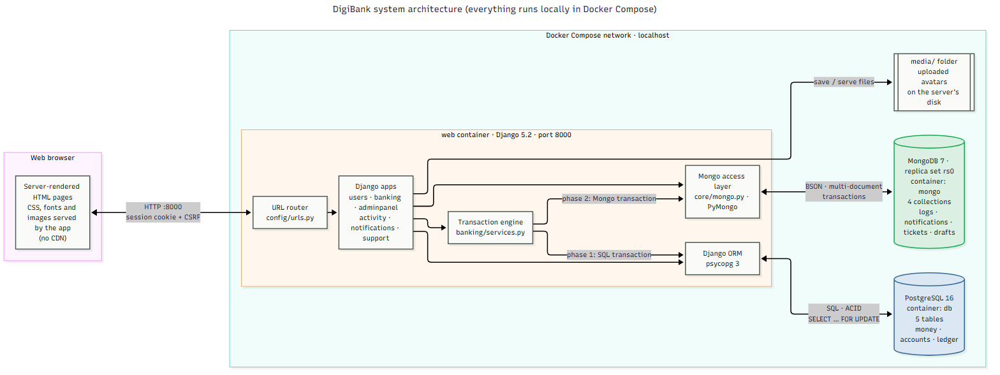](../diagrams/architecture.png)

### 4.2 SQL Database Design

PostgreSQL tables, attributes, primary and foreign keys, and relationships between users, accounts, transactions, ledger entries and beneficiaries.

[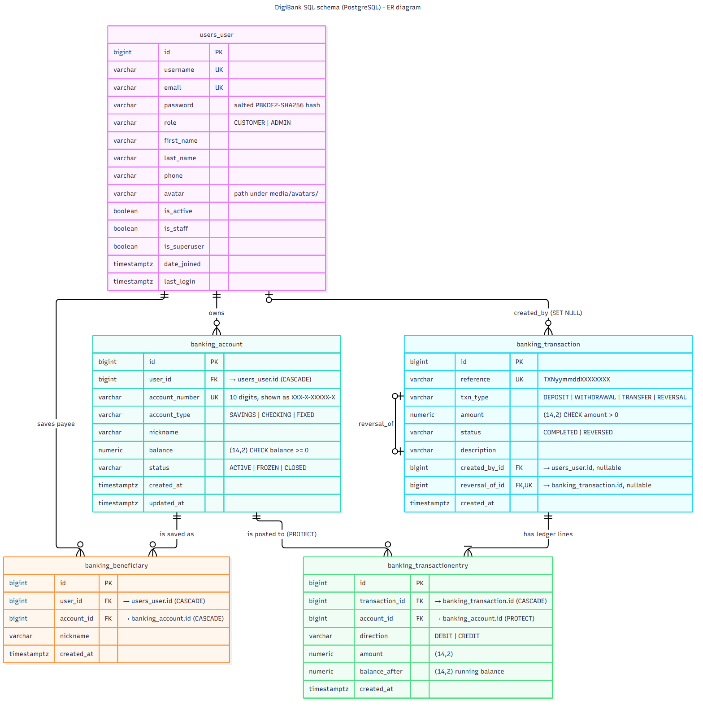](../diagrams/er-diagram.png)

### 4.3 NoSQL Database Design

MongoDB collections, document fields, embedded data and references to SQL users and accounts.

[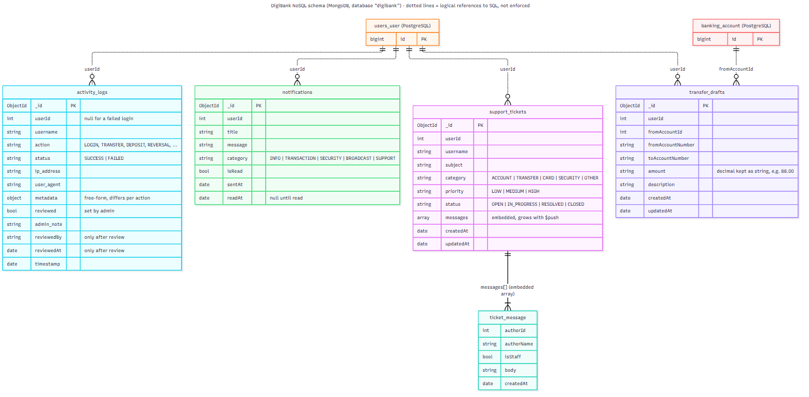](../diagrams/nosql-schema.png)

### 4.4 Transaction Workflow

Transfer flow through Django and PostgreSQL, including commit and rollback paths, followed by MongoDB activity logs, notifications and optional draft removal after SQL success.

[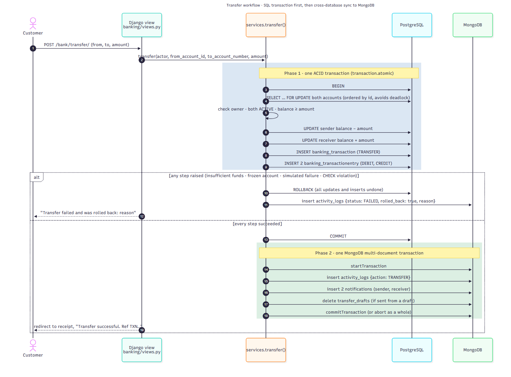](../diagrams/transfer-flow.png)
